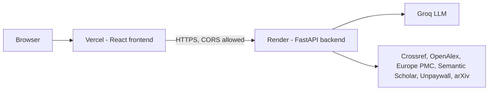

# CiteVerify

### A citation existing is not the same as a citation proving the claim.

Upload an academic PDF. CiteVerify finds the claims that need evidence, locates the cited papers, reads the open-access full text and checks whether the research really supports each statement.

---

## Live Demo

| What | Link |
|---|---|
| Web app | https://citeverify-puce.vercel.app |
| API health | https://citeverify-8916.onrender.com/api/health |
| Source code | https://github.com/Mohith417/citeverify |

> **Heads up:** the demo runs entirely on free tiers. The backend sleeps when idle, so the first request can take 30-60 seconds to wake up. Uploaded documents and history are not kept after the backend restarts.

---

## Why CiteVerify?

Papers cite other papers all the time, but readers rarely check whether the cited work actually says what is claimed. CiteVerify automates the first pass of that check and keeps a human in the loop.

- **Evidence-backed:** every verdict ships with the source passage, a confidence indicator and the publication trace.
- **No fabricated quotes:** every quotation returned by the AI is checked against the retrieved source text.
- **Honest about gaps:** "unsupported" means the accessible evidence did not establish the claim, not that it is false.
- **Human review built in:** every non-supported verdict is flagged, and can be confirmed, overridden or annotated.
- **Legal and free:** only open-access full text is used. No paywall access, no paid API required.

---

## How it works

1. **Upload:** the PDF is validated (type, size, header) and text is extracted page by page. Scanned files are detected and refused instead of pretending text was read.
2. **Extract:** an LLM returns claims verbatim. Citations such as `[1]`, `[2,3]`, `[1-4]` and author-year are parsed and linked to the bibliography. Ambiguity is preserved.
3. **Retrieve:** DOI, then exact title, then title plus author and year, matched across Crossref, OpenAlex, Europe PMC, Semantic Scholar and arXiv. A merely similar title is never accepted silently.
4. **Evidence:** open-access PDFs (OpenAlex, Unpaywall) and Europe PMC XML are fetched behind an SSRF guard. Abstracts are used only when flagged `abstract_only`.
5. **Compare:** section-aware paragraphs are ranked against the claim, and the best passages go to the verifier.
6. **Report:** verdict, explanation, facts, limitations, confidence and review flag, plus a downloadable PDF report.

### Verdicts

| Verdict | Meaning |
|---|---|
| `supported` | The cited source backs the statement |
| `partially_supported` | The source backs part of it, or with weaker strength |
| `unsupported` | Accessible evidence did not establish the statement |
| `contradictory` | The source says something different |
| `potentially_outdated` | Newer research may have changed the picture |
| `insufficient_evidence` | No usable full text or abstract was available |

---

## Tech stack

| Layer | Technology |
|---|---|
| Frontend | React 18, Vite, TypeScript, Tailwind CSS, React Router, Axios, Lucide |
| Backend | Python, FastAPI, SQLAlchemy, SQLite, Pydantic |
| AI | Groq (OpenAI-compatible), Gemini (Google AI Studio) or Ollama |
| Documents | pypdf, lxml, optional GROBID |
| Research APIs | Crossref, OpenAlex, Europe PMC, Semantic Scholar, Unpaywall, arXiv |
| Retrieval | Lexical ranking by default, optional sentence-transformers + FAISS |
| Reports | ReportLab PDF |

---

## Deployment architecture (all free)

| Part | Host | Key settings |
|---|---|---|
| Frontend | Vercel (Hobby) | Root `frontend`, env `VITE_API_URL` = backend URL |
| Backend | Render (Free) | Root `backend`, build `pip install -r requirements-deploy.txt`, start `uvicorn app.main:app --host 0.0.0.0 --port $PORT` |
| CORS | Render env var | `CORS_ORIGINS` = the Vercel domain |

`requirements-deploy.txt` drops sentence-transformers and faiss so the app fits in 512 MB of RAM. Evidence ranking then uses the deterministic lexical path.

---

## Run it locally

### 1. Backend

Open `http://127.0.0.1:8000/api/health`. `ai_configured` must be `true`.

### 2. Frontend

GROBID improves scientific structure extraction. Without it, the regex-based citation and reference parser is used and the pipeline never blocks.

---

## Configuration (`backend/.env`)

| Variable | Purpose |
|---|---|
| `AI_PROVIDER` | `gemini`, `groq`, `openai_compat`, `ollama` or `auto` |
| `AI_MODEL`, `AI_BASE_URL`, `AI_API_KEY` | OpenAI-compatible provider, e.g. Groq with `openai/gpt-oss-120b` and `https://api.groq.com/openai/v1` |
| `GEMINI_API_KEY`, `GEMINI_MODEL` | Google AI Studio key and model |
| `OLLAMA_URL`, `OLLAMA_MODEL` | Local model fallback |
| `CONTACT_EMAIL`, `UNPAYWALL_EMAIL` | Polite-pool identification and Unpaywall lookup |
| `SEMANTIC_SCHOLAR_API_KEY`, `OPENALEX_API_KEY` | Optional, raise rate limits |
| `CORS_ORIGINS` | Comma-separated frontend origins allowed to call the API |
| `MAX_UPLOAD_MB`, `MAX_CLAIMS`, `MAX_VERIFY_CLAIMS` | Pipeline limits |

Keys stay server-side. The browser only talks to the FastAPI app. Secrets live in `backend/.env`, which is git-ignored.

---

## API

| Method | Path | Purpose |
|---|---|---|
| GET | `/api/health` | Service, AI and provider status |
| GET | `/api/documents` | Recent documents |
| POST | `/api/documents/upload` | Multipart PDF upload |
| POST | `/api/documents/{id}/analyze` | Start background analysis |
| GET | `/api/documents/{id}/status` | Real processing stage |
| GET | `/api/documents/{id}/results` | Dashboard payload with summary |
| DELETE | `/api/documents/{id}` | Remove document and results |
| GET | `/api/claims/{claim_id}` | Claim, references, evidence, verification |
| POST | `/api/claims/{claim_id}/review` | Confirm, override or add a note |
| GET | `/api/references/{reference_id}` | Reference and matched publication |
| POST | `/api/documents/{id}/extract-citations` | Citation-only inspection |
| GET | `/api/documents/{id}/report` | Generated PDF report |

Schemas and rules are in `docs/API_CONTRACT.md`.

---

## Tests

cd backend && pytest -q # parsing, discovery, upload, endpoints, quote guard, SSRF
cd frontend && npm run build # type-check and production build

## Project layout
backend/
app/ FastAPI app: api, services, models, schemas, config
tests/ pytest suite
frontend/
src/ React app: pages, components, lib (api client, types)
docs/ API contract
docker-compose.yml optional GROBID service

---

## Limitations

- Only text-based PDFs are processed. OCR is not included and is reported as required.
- Reference parsing is heuristic, so unusual citation styles may be marked incomplete or ambiguous.
- Full-text retrieval depends on legal open access. Abstract-only verdicts are labelled, and with nothing available a claim is `insufficient_evidence`.
- Free AI tiers enforce rate limits. Requests are retried with backoff, but some claims may still be marked for review.
- Search APIs can be throttled unpredictably. Every provider degrades gracefully.
- Automated verdicts are indications for a human reviewer, not final academic judgments.

---

Built by [A Mohith Santosh](https://github.com/Mohith417)

